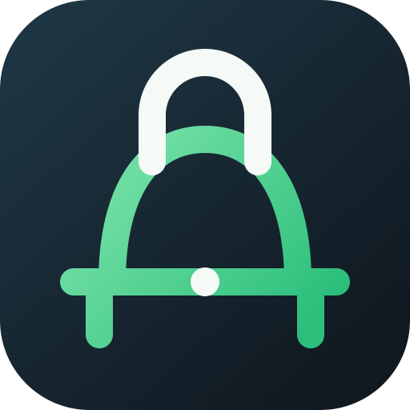

# DeckBridge

**DeckBridge — Unofficial Client for Agent Deck** brings your local Agent Deck sessions into Visual Studio Code.

> DeckBridge is an independent, community-developed extension. It is not affiliated with, endorsed by, or maintained by the [Agent Deck](https://github.com/asheshgoplani/agent-deck) project.



## Features

- Browse all Agent Deck sessions using their existing groups and live states.
- Open structured chat history powered by `agent-deck recall` and follow updates live.
- Send prompts, discover slash commands and local Agent Deck skills from the composer.
- Start and stop sessions without leaving the chat.
- Inspect tool, model, mode, context usage and the complete session ID.
- Select a model with the model chip or the guided `/model` completion.
- Create and rename sessions, move them between groups and switch supported tools with context.
- Open the same session in VS Code's integrated terminal.
- Run workspace tests and open VS Code's Test Explorer from the chat.

## Requirements

DeckBridge requires a recent local installation of the [`agent-deck` CLI](https://github.com/asheshgoplani/agent-deck#installation), its supported agent tools and `tmux`. The extension does not bundle Agent Deck.

Conversation views also require Agent Deck Recall:

```toml
[recall]
enabled = true
```

Agent Deck and `tmux` are primarily used on macOS and Linux. Windows users should run them in an environment supported by Agent Deck, such as WSL, and install DeckBridge in the matching VS Code extension host.

## Getting started

1. Install Agent Deck and verify `agent-deck version` in a terminal.
2. Install DeckBridge from the Visual Studio Marketplace.
3. Open the DeckBridge icon in the Activity Bar.
4. Select a session to open its chat, or create one with the **+** button.

If VS Code does not inherit your shell `PATH`, use **DeckBridge: Configure Agent Deck Executable** or set an absolute `deckbridge.executablePath`. Additional executable directories can be added with `deckbridge.additionalPath`.

## Settings

| Setting | Purpose |
| --- | --- |
| `deckbridge.executablePath` | Agent Deck executable name or absolute path. |
| `deckbridge.profile` | Optional Agent Deck profile passed to the CLI. |
| `deckbridge.additionalPath` | Extra executable directories prepended to `PATH`. |
| `deckbridge.showAllSessions` | Include sessions outside the open workspace. |
| `deckbridge.initialMessageLimit` | Number of recent chat rows loaded initially. |
| `deckbridge.autoStartOnOpen` | Start inactive sessions when their chat is opened. |

## Preview limitations

- File and image attachments are not available yet.
- Rich Markdown rendering is planned; current transcript content prioritizes safe plain-text display.
- Capabilities such as model and tool switching depend on the active agent and Agent Deck adapter.

## Privacy and security

DeckBridge talks only to local executables and reads local Agent Deck session data. It contains no telemetry and does not upload prompts or transcripts. The selected agent tool may have its own network and privacy behavior.

Please report vulnerabilities privately as described in [SECURITY.md](SECURITY.md). For regular questions and bugs, see [SUPPORT.md](SUPPORT.md).

## Contributing

Contributions are welcome. Read [CONTRIBUTING.md](CONTRIBUTING.md) before opening a pull request. Every behavior change or bug fix must include unit tests, and `npm test` must pass before packaging.

Release maintainers should also follow [PUBLISHING.md](PUBLISHING.md).

## License

DeckBridge is available under the [MIT License](LICENSE).
